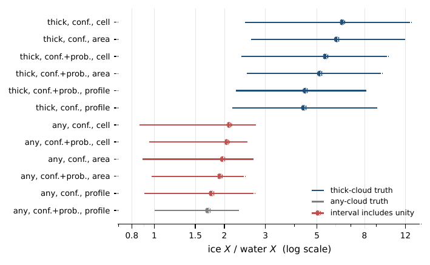

# Cloud-mask scoring conventions

  
  

  

A clear-sky validation usually condenses into one false-clear number. That number is
not a property of the mask: it moves with the truth definition, the confidence
reduction, the pooling, the metric and the matching window. This repository applies
twelve conventions to one fixed matchup set so the size of each choice is visible.

*Ice/water ratio under twelve conventions, one fixed July matchup set. Red rows are
the five whose interval includes unity.*

## What it settles

| quantity | value |
|---|---|
| matchup set | 7,123 profiles, 53 granules, April and July 2019 |
| conventions | 12 (2 truth × 2 reductions × 3 poolings) |
| ratio range | 1.70 – 6.43 |
| intervals excluding unity | 7 of 12 |
| bootstrap | 31 July granules, 2,000 replicates, seed 20261110 |

## Contents

    supp/S1_matchups.csv   the frozen matchup set (2.9 MB)
    code/p8_recompute.py   QC filter, the twelve conventions, the bootstrap
    code/tabgen.py         tables from numbers.json (single source of truth)
    code/make_figures.py   figures from numbers.json
    code/area_test.py      area weighting and the cell-aspect check
    numbers.json           every number the paper quotes

## Quick start

    pip install numpy pandas scipy matplotlib
    python code/p8_recompute.py     # QC banner, then the twelve conventions
    python code/tabgen.py           # tables/tab1_conventions.tex, tab3_metric.tex
    python code/make_figures.py     # figures/

The QC banner is the gate and must read:

    7123 rows, 53 granules (July 4246/31, April 2877/22); m35_det unique=[1]

## The paper

*Twelve conventions, one mask: how scoring choices set the answer in a clear-sky
validation* — submitted to **Cold Regions Science and Technology**.

## Licence and citation

Code MIT (`LICENSE`); the matchup table CC BY 4.0 (`DATA_LICENSE`). The MODIS and
CALIPSO source granules are public archives and are not redistributed. Cite the
article and this repository — see `CITATION.cff`.

---
[中文说明](README.zh-CN.md)
