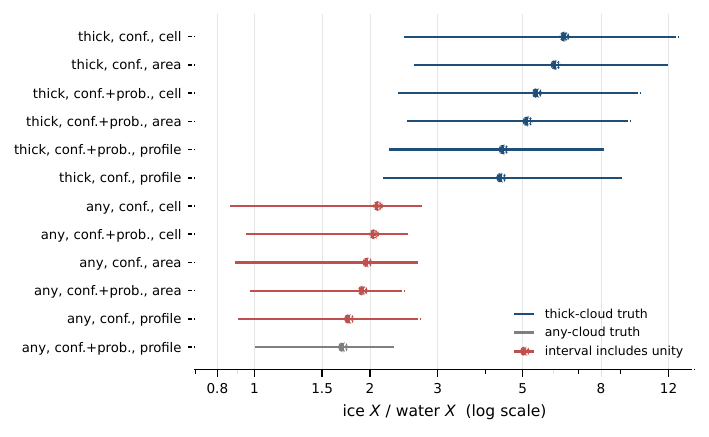

# 云检测评分约定

  
  

  

晴空验证通常被压缩成一个"误判为晴"的数。这个数不是掩膜本身的属性：它随真值定义、置信度归并、
池化方式、度量口径和匹配窗口而变。本仓把十二种约定施加在同一份固定匹配集上，让每个选择的
代价可见。

*同一份七月匹配集在十二种约定下的冰/水比值。红色为五个包含 1 的区间。*

## 它确定了什么

| 量 | 数值 |
|---|---|
| 匹配集 | 7,123 条廓线、53 个 granule、2019 年 4 月与 7 月 |
| 约定数 | 12（2 真值 × 2 归并 × 3 池化） |
| 比值范围 | 1.70 – 6.43 |
| 区间不含 1 的条数 | 12 条中 7 条 |
| 自助法 | 7 月 31 个 granule，2,000 次，seed 20261110 |

## 目录

    supp/S1_matchups.csv   冻结的匹配集（2.9 MB）
    code/p8_recompute.py   质控筛选、十二种约定、自助法
    code/tabgen.py         由 numbers.json 生成表格（唯一真值源）
    code/make_figures.py   由 numbers.json 生成图
    code/area_test.py      面积加权与像元长宽比检查
    numbers.json           论文引用的每个数字

## 快速开始

    pip install numpy pandas scipy matplotlib
    python code/p8_recompute.py     # 质控横幅，然后十二种约定
    python code/tabgen.py           # tables/tab1_conventions.tex、tab3_metric.tex
    python code/make_figures.py     # figures/

质控横幅即闸门，必须是：

    7123 rows, 53 granules (July 4246/31, April 2877/22); m35_det unique=[1]

## 对应论文

*Twelve conventions, one mask: how scoring choices set the answer in a clear-sky
validation*，拟投 **Cold Regions Science and Technology**。

## 许可与引用

代码 MIT（`LICENSE`）；匹配表 CC BY 4.0（`DATA_LICENSE`）。MODIS 与 CALIPSO 源 granule
为公开档案，不再分发。引用见 `CITATION.cff`。

---
[English](README.md)
